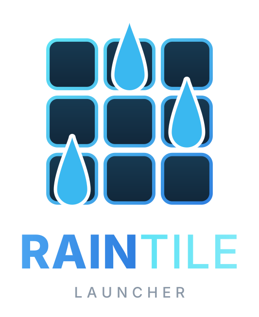

<p align="center"></p>

# Raintile

**Raintile** is a tile launcher for [Rainmeter](https://www.rainmeter.net/), full screen, in a window or docked on a side, meant to replace the icons on your Windows desktop.

Your games, apps, links and system tools become large tiles with background art and logos, organised in categories you switch between from a menu at the top. Open it with a shortcut, pick a tile with the mouse, the keyboard or a gamepad, and it gets out of the way.

## Features

- **Categories** in a centred menu at the top (icon, text or both), each with its own grid size.
- **Tiles** with background image, logo, label and any command: programs, shortcuts, URLs, folders, `steam://` links, Rainmeter bangs. Tiles can take more cells (`Size=2x2`) for a featured game or a bigger widget, one by one or all the tiles of a category at once. Backgrounds fit the tile by themselves; you can also frame each one by dragging and zooming it in Options, and move and resize its logo on its own, or set both once for a whole category (every logo on the right, say) and reset them all.
- **Add games and apps** found on this PC — Steam, Epic Games, GOG Galaxy, Ubisoft Connect, Battle.net, EA app, Xbox, and the programs of the Start menu — picking them from a list, with background and logo (local Steam cache, [SteamGridDB](https://www.steamgriddb.com/), program icons). New ones are signalled with a dot on the gear.
- **Clock and date** at the top left, and a **search** across all categories that opens when you hover it, with results that follow every key.
- **Favorites and Recent**: your favorite tiles and the ones launched lately (or most often), one click away from the buttons next to the search bar.
- **Tags**: tag your tiles (multiplayer, coop, ...); search finds them, and chips above the results filter by tag or by store with a click.
- **Play time**: hours played (from Steam, or measured by Raintile for the other games) and last launch, on a line you can drag anywhere on the tile (or once for a whole category), Steam updates on a line above it with a border on the tile and the download followed live (progress, speed, time left), and a **Not played yet** category for what you never started.
- **Games no longer installed** are found by the same search: greyed out in the launcher, removed or kept with a click.
- **Tile menu**: right click a tile to edit it, add it to Favorites, open its file location, run it as administrator or remove it.
- **Mouse, keyboard and gamepad**: WASD/arrows, Space/Enter, Xbox-compatible controllers (open the launcher with Back + Start; every button can be changed, picked on a dial or by pressing it), with an on-screen keyboard to search from the couch; the Options window works with the controller too (the right stick click, `RS`, opens it).
- **Widgets**: tiles that show CPU, GPU, memory, disks, network, processes and temperatures, in any category (a Dashboard of them is included as an example) (with [LibreHardwareMonitor](https://github.com/LibreHardwareMonitor/LibreHardwareMonitor) or [HWiNFO](https://www.hwinfo.com/)), your Rainmeter skins in a tile, custom widgets, and a widget gallery to install new ones from Options.
- **Full screen, window or docked**: the launcher can cover the screen, be a window you move around, or sit on a side of the screen and slide in when the mouse touches that edge. When the menu gets narrow, the categories scroll and the rest goes into a ☰ list. The tiles can also turn on a **wheel**: one line on an arc with the selection in the middle and the categories on an inner wheel, made for the docked launcher; the selected tile's art becomes the background, with its logo and play time on it if you like. Or keep the grid as a **carousel**: the selected column stays in the middle, and every wheel notch, key or stick move brings the next game there.
- **Power button**: lock, sleep, restart or shut down the PC from the launcher.
- **Hot keys for tiles**: give a game a key combination and start it from anywhere, even with the launcher closed.
- **Animations**: tiles appearing, smooth (and optionally infinite) scrolling, sliding highlight, logos turning from greyscale to colour, background pan/parallax/zoom, full-screen expansion when a tile is launched. Every one of them can be turned off.
- **Lightweight**: no update cycle (0% CPU at rest), a fixed number of meters however many tiles you have, thumbnails at the exact displayed size, loaded once and then just shown/hidden.
- **Options window** to edit every setting, the categories and their tiles without touching files.
- **Profiles**: save the settings, the look of the categories and the widgets' settings as named profiles (a desk and a couch setup, a docked wheel and a full-screen grid) and switch between them, or go back to the default settings; your tiles stay as they are.

## Requirements

- Windows 10 or 11
- [Rainmeter](https://www.rainmeter.net/) **4.5** or later
- The **HotKey** plugin, for the open shortcut, Esc and keyboard navigation ([HotKey.dll](https://github.com/brianferguson/HotKey.dll))
- Windows PowerShell 5.1 and .NET Framework 4.8 (both included in Windows 10/11), used for thumbnails, the search of games and apps, the gamepad helper and the Options window

## Installation

**With the package** (recommended): download the `.rmskin` file of the latest [release](https://github.com/Derek3rd/raintile/releases) and open it: the Rainmeter installer installs and loads the skin. Install the HotKey plugin too if you don't have it.

**By hand**:

1. Download or clone this repository into your Rainmeter skins folder, so that `Raintile.ini` ends up in:

   ```
   Documents\Rainmeter\Skins\Raintile\Raintile.ini
   ```

2. Install the HotKey plugin if you don't have it yet.
3. In Rainmeter: **Manage** > **Refresh all**, then load `Raintile\Raintile.ini`.
4. Press **Ctrl+Alt+G** to show or hide the launcher.

**Updates**: Raintile checks GitHub once a day and shows a dot on the gear when a new version is out; Options > Info installs it with one click (directly, or with the Rainmeter installer). Your settings, categories and images live in `%APPDATA%\Rainmeter\Raintile\`, so updating never touches them.

The launcher places itself at the top-left corner and covers the screen. Do not load the `Raintile\Hotkey`, `Raintile\Navigation` and `Raintile\Typing` skins by hand: the launcher turns them on and off by itself.

## Quick start

- **Add tiles**: right click on the launcher > **Options...**, or edit the files of right click > **Categories folder** (one file per category). Right click on a tile > **Edit \<tile\>...** opens it in Options.
- **Add your games and apps**: right click > **Add games and apps...**, tick them and press **Add selected**.
- **Images**: put them in right click > **Images folder** > `<category>\background\<TileName>.jpg` and `...\logo\<TileName>.png`; they are picked up automatically.
- **Settings**: right click > **Options...**, or **Edit Settings.inc**.
- **Back up your launcher**: Options > Info > **Back up...** (and **Restore...** on another PC).

## Documentation

Everything else — every setting, category and tile files, adding games and apps, keyboard and gamepad controls, search, animations, how it works and troubleshooting — is in the **[Guide](docs/Guide.md)**.
